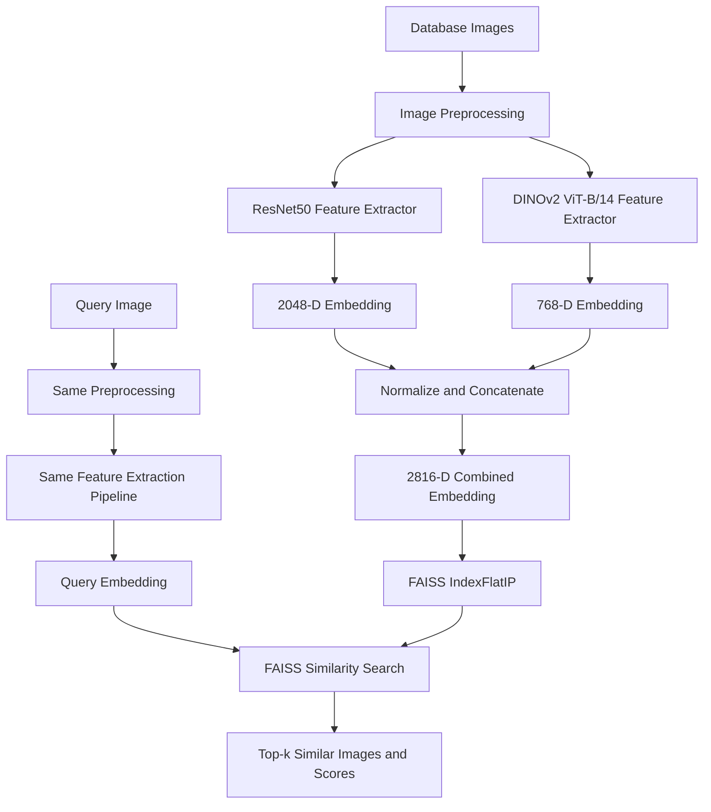

# Search by Image

A **content-based image retrieval (CBIR)** system that finds visually similar images using deep-learning image embeddings and FAISS similarity search.

Instead of searching by filenames or text labels, the system represents each image as a feature vector. Given a query image, it retrieves database images whose visual representations are most similar.

**Author:** [Mahmoud Etman](https://github.com/ma74a)

- **Repository:** https://github.com/ma74a/search-by-image
- **Live demo:** https://mahm0uda21-search-by-image.hf.space

---

## Overview

The project explores deep visual representations for image retrieval, starting with a ResNet50 baseline and extending to DINOv2 features and a combined ResNet50 + DINOv2 representation.

### Main capabilities

- Extract deep feature embeddings from images.
- Build a searchable vector index with FAISS.
- Retrieve the top-k most similar images for a query.
- Serve image search through a FastAPI application and web interface.
- Run the application with Docker.
- Explore alternative feature representations using ResNet50 and DINOv2.

## Model representations

### 1. ResNet50 baseline

A pretrained ResNet50 model is used as a feature extractor. Its final classification layer is removed, leaving a **2048-dimensional** representation for each image.

This provides a convolutional-neural-network baseline for comparing visual similarity.

### 2. DINOv2

The project also includes a DINOv2 feature-extraction pipeline. The ViT-B/14 backbone produces a **768-dimensional** image representation.

DINOv2 is a self-supervised vision transformer, providing a different visual representation from the supervised ImageNet-pretrained ResNet50 baseline.

### 3. ResNet50 + DINOv2 fusion

The combined pipeline concatenates the two embeddings:

| Feature extractor | Embedding size |
|---|---:|
| ResNet50 | 2048 |
| DINOv2 ViT-B/14 | 768 |
| **Combined representation** | **2816** |

Each feature vector is L2-normalized before concatenation, and the final combined vector is normalized again. This creates a single representation that incorporates features from both backbones.

> The repository contains separate baseline and DINOv2/fusion scripts. The exact pipeline used by a particular demo or API deployment depends on how that deployment is configured.

## System architecture



For the ResNet50-only or DINOv2-only pipelines, indexing and querying use the corresponding model's embedding rather than the fused representation.

## Retrieval workflow

1. **Preprocess the image** — convert it to RGB, resize it to the expected input size, convert it to a tensor, and normalize it.
2. **Extract features** — pass the image through the selected feature extractor.
3. **Normalize embeddings** — apply L2 normalization to make similarity comparisons consistent.
4. **Index the dataset** — add database embeddings to a FAISS index.
5. **Embed the query** — process the query image using the same feature-extraction pipeline used for the indexed images.
6. **Retrieve nearest neighbors** — search the index and return the top-k similar images with similarity scores.

### Similarity search

The retrieval implementation uses `faiss.IndexFlatIP`, which performs exact inner-product search. When embeddings are L2-normalized, inner product is equivalent to cosine similarity.

## Technology stack

- **Python**
- **PyTorch** and **Torchvision** — model inference and image preprocessing
- **ResNet50** — CNN-based visual features
- **DINOv2 ViT-B/14** — transformer-based visual features
- **FAISS** — vector indexing and nearest-neighbor retrieval
- **FastAPI** — API layer
- **Docker** — containerized deployment
- **Hugging Face Spaces** — hosted demo

## Repository structure

```text
search-by-image/
├── main.py                    # FastAPI application
├── config.py                  # Configuration
├── dataset.py                 # Image dataset and loading
├── with_faiss.py              # ResNet50-based FAISS pipeline
├── search_combined.py         # ResNet50 + DINOv2 fusion pipeline
├── dinov2/
│   ├── feature_extractor.py   # DINOv2 feature extraction
│   └── search_dinov2.py       # DINOv2 retrieval pipeline
├── requirements.txt           # Python dependencies
├── Dockerfile                 # Docker setup
├── data/                      # Image data (local)
└── saved/                     # Saved indexes and embeddings (local)
```

Generated data and saved indexes may be local and are not necessarily included in the repository.

## Getting started

### Requirements

- Python 3.9 or newer
- Dependencies listed in `requirements.txt`
- Image files for the retrieval database

### Install

```bash
git clone https://github.com/ma74a/search-by-image.git
cd search-by-image

python -m venv .venv
source .venv/bin/activate
# Windows: .venv\Scripts\activate

pip install -r requirements.txt
```

### Prepare the image collection

Place the images you want to index in the data directory expected by the selected script. Check the script's configuration and arguments before running it, as the baseline and DINOv2/fusion pipelines may use different paths or saved-index names.

### Run the API

```bash
uvicorn main:app --host 0.0.0.0 --port 8000
```

If the server starts successfully, open `http://localhost:8000/search` for the search interface. The available endpoints and expected input format are defined in `main.py`.

### Docker

```bash
docker build -t search-by-image .
docker run -p 8000:8000 search-by-image
```

## Evaluation and future work

Useful next steps for evaluating and improving the retrieval system include:

- Compare ResNet50, DINOv2, and fused embeddings on the same query set.
- Measure retrieval quality with **Recall@K** and **mean Average Precision (mAP)**.
- Measure end-to-end query latency, including feature extraction and vector search.
- Investigate feature weighting before fusion rather than assuming both representations contribute equally.
- Evaluate retrieval quality across different image categories and visual conditions.

Model quality should be reported from measured experiments; no accuracy or retrieval-quality improvement is assumed without evaluation.

## License

See [`LICENSE`](LICENSE) for the project's license.

## Author

**Mahmoud Etman**

- [GitHub](https://github.com/ma74a)
- [LinkedIn](https://www.linkedin.com/in/mahm0ud-etman/)
